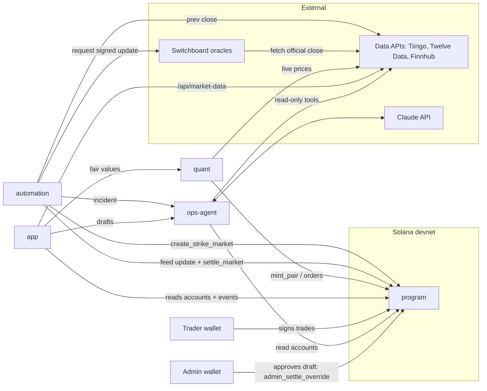

<!-- OWNER: shared. Operator may update to match reality; every change is logged in docs/decisions.md. -->
# Meridian: Architecture

Business rules and units live in [domain.md](domain.md); this file covers structure and contracts. Decision IDs refer to [decisions.md](decisions.md).

## Tech stack
| Layer | Choice | Version | Why |
|---|---|---|---|
| Chain | Solana devnet; `solana-test-validator` locally | Agave CLI 2.1.x (exact patch pinned by M1-01 to match Anchor 0.31.1) | Sub-second finality; PRD preference (D-001) |
| Program | Rust + Anchor | anchor-lang / anchor-cli **0.31.1**; Rust toolchain pinned in `rust-toolchain.toml` | PRD preference (D-001); version matches Switchboard's Solana SDK examples (D-005) |
| Order book | Own CLOB: `crates/meridian-book` (pure Rust) used by the program | n/a | Atomic Buy/Sell NO, fully testable (D-002, D-022) |
| Tokens | Classic SPL Token | anchor-spl 0.31.1 | Mint authority = market PDA; nothing from Token-2022 needed (D-003) |
| Oracle | Switchboard On-Demand pull feeds (custom HTTP jobs) | `switchboard-on-demand` crate 0.13.x (latest supporting anchor-lang 0.31.1); `@switchboard-xyz/on-demand` TS | Free on devnet, multi-source median, feed hash pinning; Pyth equities now paid (D-005) |
| Program tests | LiteSVM (Rust), proptest | latest | Fast in-process tests; property tests for invariants (D-017) |
| Frontend | Next.js (App Router) + React + TypeScript + Tailwind | Next 15, React 19, TS 5.x | PRD (D-001) |
| Wallets | `@solana/wallet-adapter-react` (Phantom, Solflare) | latest | Standard (D-026) |
| Solana JS | `@coral-xyz/anchor` + `@solana/web3.js` v1 + `@solana/spl-token` | 0.31.1 / 1.98.x / 0.4.x | Anchor's TS client requires web3.js v1 |
| Charts | Recharts | latest 2.x | Boring, well-known |
| Validation | zod (TS), pydantic 2 (Python) | latest | Validate every external input |
| Automation | Node + TypeScript, `node-cron` (TZ America/New_York) | Node 22 LTS | PRD (D-001) |
| Quant + MM, ops agent | Python, `solders` + `solana` (solana-py), `httpx`, `pydantic`, `anthropic` | Python 3.12 | PEAK6's stack where the PRD is silent (D-018) |
| LLM | Anthropic Claude API | model from `OPS_AGENT_MODEL` (default `claude-sonnet-5-5`) | Ops agent only (D-025) |
| Package managers | pnpm (JS), uv (Python), cargo | pnpm 9, uv latest | Workspaces + lockfiles (D-032) |
| TS/Python tests | Vitest + fast-check; pytest + hypothesis; Playwright (UI smoke, M2) | latest | Property tests for numeric logic (D-017) |
| Lint/format | ESLint 9 + Prettier; rustfmt + clippy; ruff + mypy | latest | Standard |
| CI | GitLab CI, shared runners | n/a | Repo host (D-016) |
| Hosting | Vercel (app), Railway (automation, quant, ops-agent) | free / ~$5 mo | D-015 |

## Components
| Component | Path | Responsibility |
|---|---|---|
| `program` | `programs/meridian` | All on-chain state and rules: config, markets, mint/redeem, book, settlement, pause. Emits events for every change |
| `book` | `crates/meridian-book` | Matching engine over a fixed-capacity book; no Solana types; deterministic |
| `client` | `packages/client` | Generated Anchor client, PDA helpers, units, intent→instruction mapping for the 4 trade paths, event decoding |
| `app` | `app/` | Next.js UI (Markets, Trade, Portfolio, History, `/status`, admin override); API routes: `/api/faucet`, `/api/market-data` (server-side data-API proxy + fair values), `/api/ops/drafts` (proxy to ops-agent drafts) |
| `automation` | `services/automation` | Strike calculator, NYSE calendar, morning job, settlement job (builds the Switchboard update + `settle_market` tx), alerts, health endpoint |
| `quant` | `services/quant` | Fair-value engine; market-maker loop; HTTP `GET /fair-values` |
| `ops-agent` | `services/ops-agent` | On settlement failure: read-only investigation with Claude, incident note, validated override draft; HTTP API for the admin page |
| Oracle feeds | `oracle/feeds/` | Switchboard feed definitions (two per ticker: Tiingo and Twelve Data official close) + scripts to register/update them |
| Scripts | `scripts/` | Devnet deploy, lifecycle, e2e, Switchboard spike, CI guard and heartbeat |

### App structure (M3-04, M3-06)
**Status page** (`/status`): Reads Config and all Markets from the chain, checks vault USDC against `pairsOutstanding × 1_000_000` (base units per pair). Displays liveness (market creation time vs 09:00 ET, settlement delay vs close from on-chain events), on-chain pause state, and any invariant violations. Client-rendered (`"use client"`).

**Admin override flow** (`app/src/components/admin-override/`): Fetches drafts from `/api/ops/drafts` (which proxies ops-agent's `GET /drafts`), validates each draft against the program's override rules (market must be Open/unsettled; `now >= close_ts + override_delay_secs`), and builds `admin_settle_override` transactions for the admin wallet to sign. The proposed price is checked against source range as a sanity cue (not a rejection gate). Drafts that fail the Open or delay check cannot be approved.

**API routes**:
- `/api/faucet`: Devnet USDC faucet (rate-limited per wallet)
- `/api/market-data`: Server-side proxy to Tiingo/Twelve Data + quant's fair values
- `/api/ops/drafts`: Server-side proxy to ops-agent's `GET /drafts`, validates response schema

## Data flow

**Morning:** `automation` reads each ticker's previous official close from the data APIs, computes strikes ([domain.md](domain.md#strike-algorithm)), and sends one `create_strike_market` per strike (skipping ones that exist).
**Intraday:** traders sign orders from `app`; `quant` keeps two-sided quotes around fair value; `app` renders books from on-chain accounts and history/P&L from program events.
**Settlement:** at close + 5 min, `automation` checks off-chain that both sources report today's close, then builds a transaction with the two Switchboard feed update instructions followed by `settle_market` for each open market of that ticker. On repeated failure it alerts and posts an incident to `ops-agent`, which investigates and publishes a draft; the admin approves it in `app`, which builds `admin_settle_override` for the admin's wallet to sign after the delay.
**Redeem:** traders call `settle_funds` (automatic in UI) then `redeem`.

## Interfaces and contracts
**Program instructions** (args → key checks; full rules in domain.md):
| Instruction | Signer | Args |
|---|---|---|
| `initialize_config` | deployer → becomes admin | automation_authority, usdc_mint, tickers[7] {symbol, feeds[2], feed_hashes[2]}, max_staleness_slots, max_conf_bps, override_delay_secs |
| `update_config` | admin | same fields (not admin itself) |
| `create_strike_market` | automation authority | ticker, strike_cents, trading_date, close_ts |
| `add_strike` | admin | ticker, strike_cents, trading_date, close_ts |
| `mint_pair` | user | qty |
| `place_order` | user | side (Bid/Ask), price (1–99), qty, kind (Limit/Ioc) |
| `cancel_order` | order owner | order_id |
| `settle_funds` | owner | — |
| `buy_no` | user | qty, price (YES price floor), kind |
| `sell_no` | user | qty, price (YES price cap) |
| `settle_market` | anyone | — (two oracle feed accounts passed) |
| `admin_settle_override` | admin | settle_price (cents) |
| `redeem` | user | yes_qty, no_qty (pair mode if both before settlement; winner mode after) |
| `pause` / `unpause` | admin | — |
| `local_oracle_set` | test only, feature `local-oracle` | ticker, source slot (0/1), value, slot — **never in devnet builds** (AB-22) |

**Events:** `MarketCreated`, `PairsMinted`, `OrderPlaced`, `OrderCancelled`, `Fill {maker, taker, price, qty, taker_side}`, `FundsSettled`, `MarketSettled {price, source, oracle_slot}`, `Redeemed`, `Paused`, `Unpaused`.
**Service HTTP contracts** (JSON, internal; authenticated with `SERVICE_TOKEN` bearer):
- `quant` `GET /fair-values` → `[{market, ticker, strike_cents, fair_cents, sigma, spot, as_of}]`
- `ops-agent` `POST /incidents` `{trading_date, ticker, markets[], failure}` → `{incident_id}`; `GET /drafts` → `[{incident_id, market, proposed_price_cents, sources[{name, close, as_of}], spread_bps, note, status}]`
- `automation` `GET /health` → last morning run, last settlement run, failures.
- `app` `POST /api/faucet` `{wallet}` → tx signature or 429.

## Data model (on-chain accounts)
| Account | PDA seeds | Key fields |
|---|---|---|
| Config | `["config"]` | admin, automation_authority, usdc_mint, paused, max_staleness_slots (30), max_conf_bps (5), override_delay_secs (3600), tickers[7] {symbol [u8;8], feeds [Pubkey;2], feed_hashes [[u8;32];2]} (one feed per data source) |
| Market | `["market", symbol, trading_date_le, strike_cents_le]` | ticker, strike_cents, trading_date, close_ts, yes_mint, no_mint, vault, escrow_usdc, escrow_yes, book, pairs_outstanding, status (Open/Settled), outcome (None/Yes/No), settle_price_scaled (i128), settle_slot, settled_at, settle_source (Oracle/Override) |
| YES / NO mint | `["yes", market]`, `["no", market]` | decimals 0, authority = market PDA |
| Vault | `["vault", market]` | USDC token account, authority = market PDA, collateral only |
| Escrow USDC / YES | `["escrow_usdc", market]`, `["escrow_yes", market]` | funds of resting orders |
| Book (zero-copy) | `["book", market]` | bids[32], asks[32] of {order_id, owner, price, qty, seq}; next_seq |
| OpenOrders | `["oo", market, owner]` | owner, free_usdc, free_yes, resting_count |
| LocalFeed | `["local_feed", symbol, [source_slot]]` | Test-only (feature `local-oracle`): holds oracle value and slot for one source (0=Tiingo, 1=Twelve Data) per ticker. **Never in devnet builds** (AB-22) |

Off-chain state: none required. `ops-agent` keeps incidents/drafts in a JSON file on its volume; `automation` keeps run logs.

## External services
| Service | Access | On failure |
|---|---|---|
| Solana RPC (devnet) | `SOLANA_RPC_URL` / `SOLANA_WS_URL` | Retry with backoff; app shows "network degraded" banner |
| Switchboard On-Demand | Feed definitions in `oracle/feeds/`; update via `@switchboard-xyz/on-demand` | Settlement retries 30 s × 15 min, then alert + ops agent; admin override after delay |
| Tiingo, Twelve Data, Finnhub | HTTPS with API keys (server-side only) | Morning job: use any source available, require ≥ 2 agreeing for strikes else alert; app: show last price with age; quant: pull quotes when stale |
| Anthropic Claude | `ANTHROPIC_API_KEY`, `OPS_AGENT_MODEL` | Agent falls back to a deterministic incident note (source table + median) without a narrative; admin can still override |
| Alert webhook | `ALERT_WEBHOOK_URL` (POST JSON) | Log locally; never block jobs |
| Vercel / Railway | Deploy via CLI with tokens in GitLab CI variables | Previous deployment keeps serving |

## Target directory structure
```
.
├── Anchor.toml  Cargo.toml  rust-toolchain.toml
├── package.json  pnpm-workspace.yaml  pyproject.toml  uv.lock  Makefile
├── .gitlab-ci.yml  .env.example  .gitignore  CLAUDE.md  README.md
├── programs/meridian/        # Anchor program (src/{lib.rs,state/,instructions/,oracle.rs,errors.rs,events.rs}, tests/)
├── crates/meridian-book/     # matching engine
├── packages/client/          # TS client, intents, units
├── app/                      # Next.js
├── services/automation/      # TS
├── services/quant/           # Python
├── services/ops-agent/       # Python (evals/ holds the injection/jailbreak suite)
├── oracle/feeds/             # Switchboard feed definitions
├── scripts/                  # deploy, lifecycle, e2e, spike, ci guards
├── tests/e2e/                # lifecycle smoke
├── tests/security/           # abuse-case tests: program/ (Rust), ts/, py/
└── docs/
```
