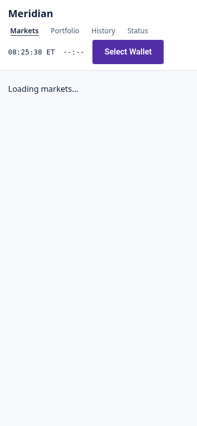
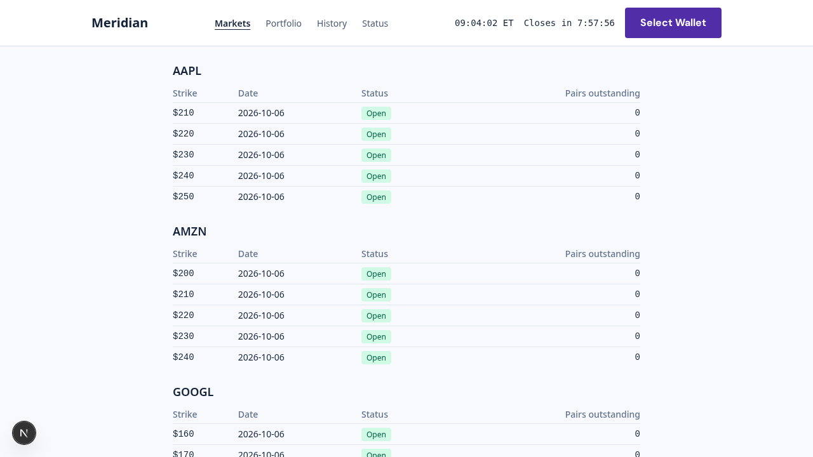
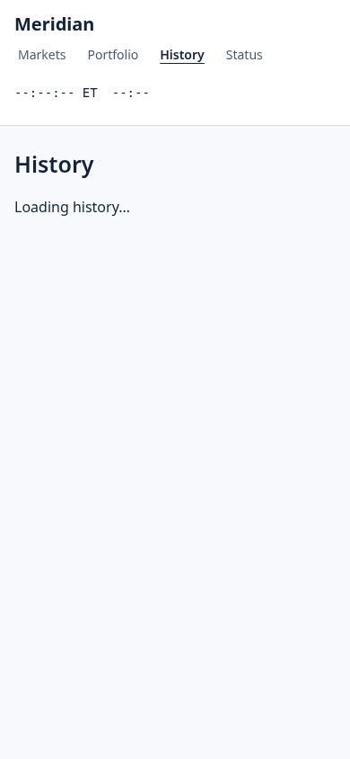
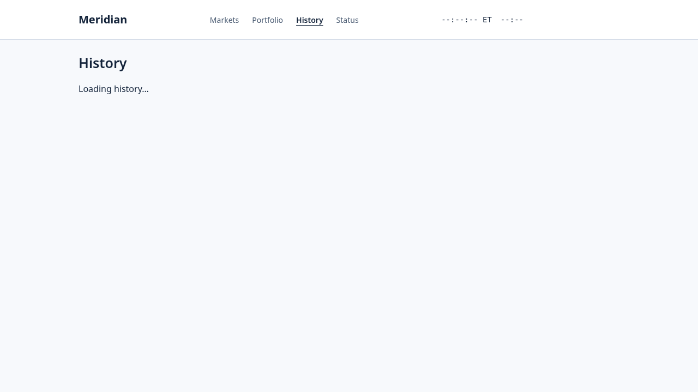
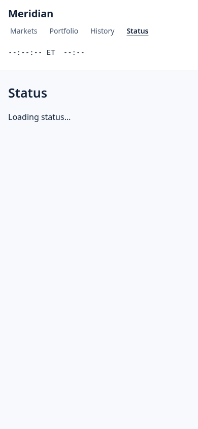
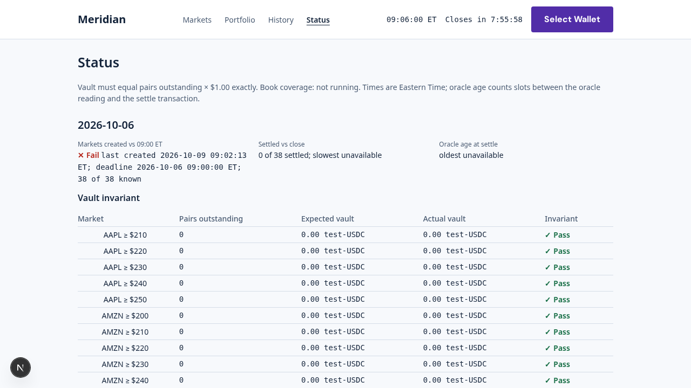

<!-- OWNER: operator. -->
# Demo Walkthrough

This walkthrough demonstrates the four core trade intents on Meridian: buying YES, buying NO, selling YES, and selling NO.

## Prerequisites

Start the local environment:
```bash
make dev  # validator :8899 + app :3000
```

## 1. Markets View

The home page shows all available binary outcome markets for today's trading session.

**Mobile (390px):**


**Desktop (1280x720):**


Each market displays:
- Ticker symbol (e.g., AAPL, MSFT)
- Strike price
- Current YES/NO prices
- Time until market close (4:00 PM ET)

## 2. Trade View

> **Note:** The dedicated `/trade/[market]` route will be available once M2-06 (!49) merges. Screenshots will be added at that time.

Clicking a market will open the trade interface where you can buy or sell YES/NO contracts.

### Trade Intent 1: Buy YES
1. Select YES side
2. Enter quantity (e.g., 10 contracts)
3. Review price (shown in cents per contract)
4. Click "Buy YES"
5. Confirm transaction in wallet
6. Outcome: You receive 10 YES tokens in your portfolio

### Trade Intent 2: Buy NO
1. Select NO side  
2. Enter quantity
3. Review price
4. Click "Buy NO"
5. Confirm transaction
6. Outcome: You receive NO tokens

### Trade Intent 3: Sell YES
1. Must own YES tokens first (via Buy YES or Mint Pair)
2. Select YES side, choose "Sell"
3. Enter quantity to sell
4. Review proceeds
5. Click "Sell YES"
6. Confirm transaction
7. Outcome: YES tokens burned, USDC proceeds credited

### Trade Intent 4: Sell NO
1. Must own NO tokens first
2. Select NO side, choose "Sell"
3. Enter quantity
4. Review proceeds
5. Click "Sell NO"
6. Confirm transaction
7. Outcome: NO tokens burned, USDC proceeds credited

## 3. Portfolio View

> **Note:** Portfolio page screenshots pending M2-07 (!51) merge.

Shows your current holdings across all markets.

Displays:
- YES/NO token balances per market
- Current position value
- Unrealized P&L based on current market prices
- Available USDC balance

## 4. History View

Transaction history showing all your trades, mints, and redemptions.

**Mobile:**


**Desktop:**


Each entry shows:
- Transaction type (Buy, Sell, Mint, Redeem)
- Market ticker and strike
- Quantity and price
- Timestamp
- Transaction signature (link to Solana Explorer)

## 5. Faucet (Admin)

Test-USDC faucet for funding wallets on devnet.

> **Screenshots pending** (technical limitation: headless browser environment cannot start full dev stack in reasonable time).

- Connect wallet
- Click "Request Test USDC"
- Receive 100 test-USDC for trading
- Use only on devnet/localnet

## 6. Status Page

System health and market statistics.

**Mobile:**


**Desktop:**


Shows:
- Validator connection status
- Program deployment info
- Active markets count
- 24h trading volume
- Last oracle update timestamp

## Settlement and Redemption

After 4:00 PM ET close:
1. Oracle fetches closing prices from Pyth Pro (cross-checked with RedStone)
2. Markets settle (YES wins if close ≥ strike, else NO wins)
3. Winners redeem tokens for $1.00 USDC per contract
4. Losers' tokens have zero value

See [docs/domain.md](domain.md) for full trading rules and settlement mechanics.

## Video

_Video walkthrough to be added in M4-05._
